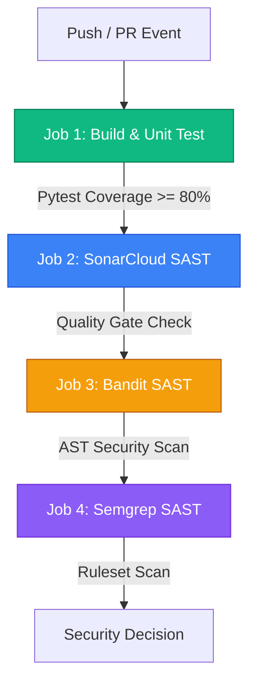

# Flaskr — DevSecOps Automated Security Pipeline Lab

[](https://github.com/aria-nf/devsecops-p5-0110225037/actions/workflows/devsecops.yml)
[](https://sonarcloud.io/summary/new_code?id=aria-nf_devsecops-p5-0110225037)
[](https://sonarcloud.io/summary/new_code?id=aria-nf_devsecops-p5-0110225037)
[](https://sonarcloud.io/summary/new_code?id=aria-nf_devsecops-p5-0110225037)

Repositori ini merupakan implementasi laboratorium **DevSecOps Pipeline** komprehensif pada aplikasi web **Flaskr** (Python Flask & Tailwind CSS). Lab ini mendemonstrasikan integrasi *Shift-Left Security* dengan automated security gates yang mencakup **Unit Testing + Code Coverage Gate (Pytest)**, **SonarCloud SAST & Quality Gate**, **Bandit (Python AST Security Scanner)**, dan **Semgrep (Semantic Security Scanner)**.

---

## 1. Struktur Branch & Komparasi Lab (Before vs After)

Repositori ini sengaja dirancang memiliki 2 branch utama untuk mempermudah audit, penilaian praktikum, dan pengujian regresi keamanan:

```text
               ┌────────────────────────────────────────────────────────┐
               │                     BRANCH BEFORE                      │
               │  - Status Pipeline : FAILED / BLOCKED ❌              │
               │  - SonarCloud      : Quality Gate Failed (Red)         │
               │  - Bandit & Semgrep: 4 Vulnerabilities Detected        │
               └────────────────────────────────────────────────────────┘
                                            ▲
                                            │ (Injeksi Celah Baseline)
┌───────────────────────────────────────────┴────────────────────────────┐
│                              BRANCH MAIN                               │
│  - Status Pipeline : 100% SUCCESS / PASSED ✅                           │
│  - SonarCloud      : Quality Gate Passed (Green, Rating A)             │
│  - Bandit & Semgrep: 0 Vulnerabilities (Clean AST & Semantic Rules)    │
│  - Unit Testing    : 24/24 Passed, 100% Code Coverage                  │
└────────────────────────────────────────────────────────────────────────┘
```

| Metrik Keamanan / Gate | Branch `before` (Insecure) | Branch `main` (Secure / Remediasi) |
| :--- | :---: | :---: |
| **Pipeline Overall** | ❌ **FAILED (Blocked)** | ✅ **PASSED (Green)** |
| **Pytest Coverage Gate** | ✅ Passed (Coverage $\ge$ 80%) | ✅ Passed (100% Coverage) |
| **SonarCloud SAST** | ❌ **FAILED** (Security Rating E, Blocker Issues) | ✅ **PASSED** (Security Rating A) |
| **Bandit Scanner** | ❌ **FAILED** (High/Medium Severity Issues) | ✅ **PASSED** (0 Issues) |
| **Semgrep Scanner** | ❌ **FAILED** (OWASP Injection Detected) | ✅ **PASSED** (0 Issues) |

---

## 2. Rincian 4 Celah Keamanan yang Diuji

Pada branch `before`, 4 celah keamanan nyata (*Common Weakness Enumeration / CWE*) disuntikkan secara alami untuk membuktikan efektivitas deteksi scanner:

### 1. SQL Injection (CWE-89 / OWASP A03:2021)
- **Lokasi Berkas**: [`flaskr/blog.py`](flaskr/blog.py) pada fungsi `get_post(id)`
- **Kode Rentan (`before`)**:
  ```python
  post = get_db().execute(
      f"SELECT p.id, title, body, created, author_id, username"
      f" FROM post p JOIN user u ON p.author_id = u.id"
      f" WHERE p.id = {id}"  # Rentan SQL Injection via string interpolation
  ).fetchone()
  ```
- **Remediasi (`main`)**: Menggunakan parameterized query dengan placeholder `?`:
  ```python
  post = get_db().execute(
      "SELECT p.id, title, body, created, author_id, username"
      " FROM post p JOIN user u ON p.author_id = u.id"
      " WHERE p.id = ?",
      (id,),
  ).fetchone()
  ```

### 2. Penggunaan Algoritma Hashing Lemah MD5 (CWE-327 / OWASP A02:2021)
- **Lokasi Berkas**: [`flaskr/auth.py`](flaskr/auth.py) pada endpoint `register()` dan `login()`
- **Kode Rentan (`before`)**:
  ```python
  hashed_password = hashlib.md5(password.encode("utf-8")).hexdigest()
  ```
- **Remediasi (`main`)**: Menggunakan algoritma password hashing adaptif dan tersalt (*PBKDF2/scrypt*) via Werkzeug:
  ```python
  from werkzeug.security import generate_password_hash, check_password_hash
  hashed_password = generate_password_hash(password)
  ```

### 3. Hardcoded Secret Key (CWE-798 / OWASP A07:2021)
- **Lokasi Berkas**: [`flaskr/__init__.py`](flaskr/__init__.py)
- **Kode Rentan (`before`)**:
  ```python
  app.config.from_mapping(
      SECRET_KEY="super_secret_hardcoded_production_key_12345",
      DATABASE=os.path.join(app.instance_path, "flaskr.sqlite"),
  )
  ```
- **Remediasi (`main`)**: Mengambil `SECRET_KEY` dari environment variable dengan fallback yang aman:
  ```python
  secret_key = os.environ.get("SECRET_KEY", "dev-secure-fallback-key-only")
  app.config.from_mapping(SECRET_KEY=secret_key, DATABASE=os.path.join(app.instance_path, "flaskr.sqlite"))
  ```

### 4. Flask Application Debug Mode Enabled in Production (CWE-215 / CWE-94)
- **Lokasi Berkas**: [`wsgi.py`](wsgi.py)
- **Kode Rentan (`before`)**:
  ```python
  app.run(host="0.0.0.0", port=5000, debug=True)  # Membuka Werkzeug Interactive Debugger & RCE risk
  ```
- **Remediasi (`main`)**: Mematikan debug mode dan mengikat hanya ke localhost pada standalone run:
  ```python
  debug_flag = os.environ.get("FLASK_DEBUG", "0").lower() in ("1", "true")
  app.run(host="127.0.0.1", port=5000, debug=debug_flag)
  ```

---

## 3. Panduan Setup Lengkap SonarCloud & GitHub Secrets

Berikut adalah langkah-langkah detail untuk mengonfigurasi SonarCloud dari nol:

### Langkah 1: Registrasi & Import Proyek ke SonarCloud
1. Buka [https://sonarcloud.io](https://sonarcloud.io) dan login menggunakan akun GitHub Anda.
2. Klik tombol **`+`** di pojok kanan atas $\rightarrow$ **Analyze new project**.
3. Pilih organisasi GitHub Anda (`aria-nf`), lalu centang repositori `devsecops-p5-0110225037` $\rightarrow$ klik **Set up**.
4. Pilih metode analisis: **GitHub Actions** (bukan Automatic Analysis).

### Langkah 2: PENTING — Setting Default Branch (`master` ke `main`)
> ⚠️ **Catatan Kritis**: Secara historis, template lama SonarCloud kerap mengasumsikan branch utama bernama `master`. Jika repository GitHub Anda menggunakan `main`, scanner akan memunculkan warning:
> `WARN Could not find ref 'master' in refs/heads...` dan menghitung 0 baris kode baru (*Quality Gate lolos palsu*).
1. Di SonarCloud, buka halaman proyek Anda.
2. Masuk ke menu **Administration** $\rightarrow$ **Branches & Pull Requests**.
3. Jika branch utama masih bertuliskan `master`, klik tombol titik tiga (**...**) di sampingnya $\rightarrow$ pilih **Rename branch** $\rightarrow$ ubah menjadi `main`.
4. Pastikan label branch `main` memiliki tanda **Main Branch** (tipe `LONG`).

### Langkah 3: Membuat SonarCloud User Token
1. Di SonarCloud, klik avatar profil Anda di pojok kanan atas $\rightarrow$ **My Account**.
2. Masuk ke tab **Security**.
3. Di bagian **Generate Token**:
   - Berikan nama token (misalnya: `gh-actions-token`).
   - Tipe: **User Token**.
   - Klik **Generate** dan salin string token yang muncul.

### Langkah 4: Menambahkan Token ke GitHub Secrets
1. Buka repositori Anda di GitHub: `https://github.com/aria-nf/devsecops-p5-0110225037`.
2. Klik tab **Settings** $\rightarrow$ menu kiri **Secrets and variables** $\rightarrow$ **Actions**.
3. Klik tombol **New repository secret**:
   - **Name**: `SONAR_TOKEN`
   - **Secret**: Masukkan token yang Anda salin dari SonarCloud pada Langkah 3.
4. Klik **Add secret**.

### Langkah 5: Konfigurasi Berkas `sonar-project.properties`
Pastikan berkas [`sonar-project.properties`](sonar-project.properties) di root repositori berisi:

```ini
sonar.organization=aria-nf
sonar.projectKey=aria-nf_devsecops-p5-0110225037
sonar.projectName=devsecops-p5-0110225037
sonar.sources=flaskr,wsgi.py
sonar.tests=tests
sonar.python.version=3.11
sonar.python.coverage.reportPaths=coverage.xml
```

---

## 4. Arsitektur DevSecOps Pipeline ([.github/workflows/devsecops.yml](.github/workflows/devsecops.yml))

Pipeline dieksekusi secara otomatis setiap kali ada event `push` atau `pull_request`:



1. **Job 1 (`build`)**:
   - Checkout code dengan Python 3.11.
   - Menjalankan 24 test Pytest dengan coverage threshold minimal 80%:
     ```bash
     python -m pytest --cov=flaskr --cov-report=term --cov-report=xml --cov-fail-under=80
     ```
2. **Job 2 (`sonarcloud`)**:
   - Menggunakan action resmi `SonarSource/sonarqube-scan-action@v6`.
   - Menguji *Quality Gate* dengan `SonarSource/sonarqube-quality-gate-action@v1`. Jika ditemukan blocker vulnerability atau rating di bawah A, job ini akan **FAILED**.
3. **Job 3 (`sast-bandit`)**:
   - Menguji kerentanan spesifik Python:
     ```bash
     bandit -r flaskr wsgi.py -ll
     ```
   - Parameter `-ll` memblokir pipeline jika ada temuan tingkat *Medium* atau *High*.
4. **Job 4 (`sast-semgrep`)**:
   - Menjalankan ruleset keamanan OWASP Top 10 dan Python security standards. Menggagalkan pipeline jika terdapat pelanggaran (*exit-code non-zero*).

---

## 5. Cara Menjalankan Aplikasi Secara Lokal

### Prasyarat
- Python 3.10+
- Git

### Langkah Menjalankan:
```powershell
# 1. Clone repository
git clone https://github.com/aria-nf/devsecops-p5-0110225037.git
cd devsecops-p5-0110225037

# 2. Buat virtual environment
python -m venv .venv
.\.venv\Scripts\Activate.ps1   # Di Linux/macOS: source .venv/bin/activate

# 3. Install dependencies
pip install -r requirements.txt

# 4. Inisialisasi Database SQLite
flask --app flaskr init-db

# 5. Jalankan server lokal
python wsgi.py
```
Akses melalui browser di: **`http://127.0.0.1:5000`**

### Menjalankan Pengujian & Scanner Keamanan Lokal:
```powershell
# Jalankan test suite Pytest dengan coverage report
python -m pytest --cov=flaskr --cov-report=term --cov-fail-under=80

# Jalankan Bandit SAST lokal
bandit -r flaskr wsgi.py -ll

# Jalankan Semgrep lokal (jika terinstall)
semgrep scan --config auto flaskr/
```

---

## 6. Petunjuk Verifikasi Lab untuk Dosen / Penguji

1. **Untuk melihat kondisi rentan (Stage BEFORE):**
   ```bash
   git checkout before
   ```
   Buka tab **Actions** di GitHub. Amati bahwa pipeline pada commit branch `before` berstatus **FAILED ❌** pada SonarCloud SAST, Bandit, dan Semgrep.

2. **Untuk melihat kondisi aman / hasil remediasi (Stage AFTER):**
   ```bash
   git checkout main
   ```
   Buka tab **Actions** di GitHub. Amati bahwa seluruh job (`build`, `sonarcloud`, `sast-bandit`, `sast-semgrep`) berstatus **SUCCESS ✅ 100% Green**.
